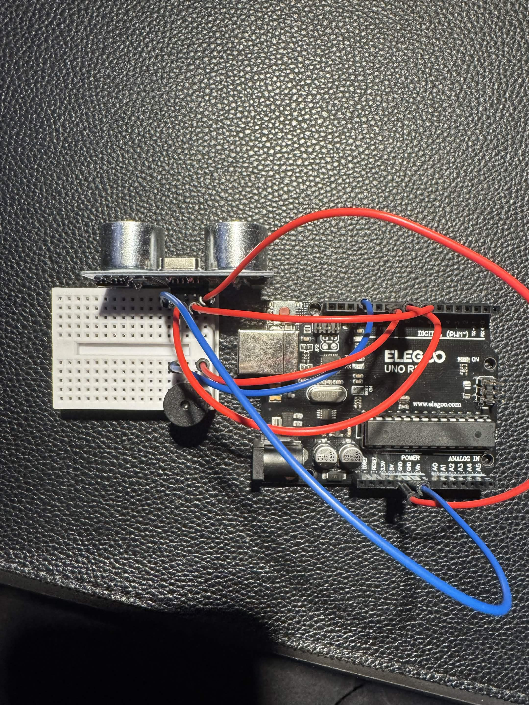

# Distance Alarm

When something is in front of the ultrasonic sensor, the buzzer beeps. The closer it gets, the faster it beeps.

## Design

## Circuit

[Watch it work](Distance_Alarm_VideoDemonstration.mov)

## Problems and Fixes
- **Junk readings up close:** covering the sensor gave false readings like 795, since it can't measure under about 2cm. Fixed by only beeping when the distance is between 0 and 30cm.
- **Close-range beeps never triggered:** the 5cm check came after the 30cm check, so the 30cm block always caught it first. Fixed by putting the most specific condition first in the `if / else if` chain.
- **Buzzer stuck on:** the close-range block turned the buzzer HIGH but never LOW, so it sounded like one long tone. Fixed by adding the off half of each beep.
- **Beeping too slow:** a 100ms delay at the end of every loop capped the beep speed. Fixed by shortening the beep, the pause, and the loop delay.
