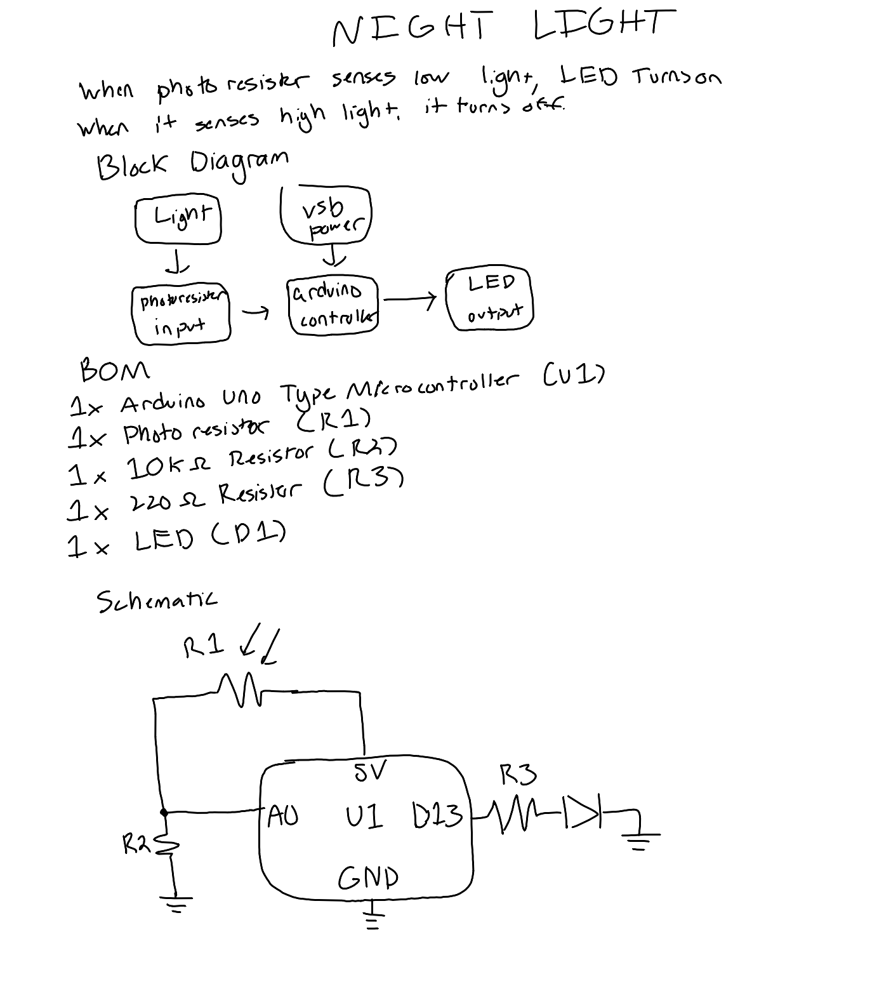
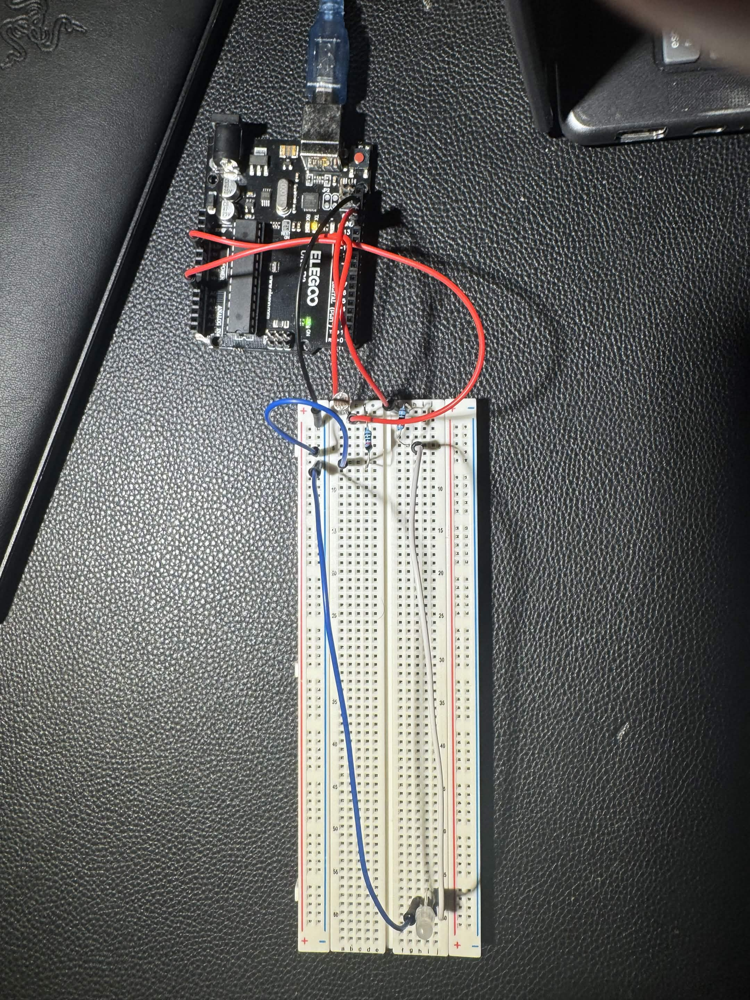

# Night Light

When the photoresistor senses low light, the LED turns on. When it senses high light, it turns off.

## Design

## Circuit

[Watch it work](Night_Light_VideoDemonstration.mov)

## Problems and Fixes
- **Feedback loop:** the LED's own light hit the photoresistor and turned itself off. Fixed by moving the LED to the far side of the breadboard.
- **Flicker at dusk:** readings hovering near the threshold made the LED flicker. Fixed with hysteresis: on below 120, off above 150.
